# 聽伴

給聽損患者與家屬用的聽力健康自我照護工具。英文名 tingpal，舊名 HearWell；repo、資料庫和服務這些內部名稱沿用舊名（[ADR 0039](docs/adr/0039-renamed-to-tingpal.md)）。

台灣 65 歲以上長者約四成有失能性聽損[^1]，但從察覺聽力問題到尋求協助往往拖延多年，有研究指出可達 10 年[^2]。這段延遲的代價不只是聽不清楚：沒有處理的聽力損失與孤獨、社交孤立有關[^3]，也是可改變的失智風險因子之一[^4]。

聽伴在家就能用：還沒就醫的人，用標準化量表自我評估聽力對生活的影響，結果用白話說明並告訴下一步該做什麼；有耳鳴的人，可以評估耳鳴造成的困擾；打算配助聽器的人，有一步一步的選配指引；已經戴助聽器的人，可以評估助聽器帶來的幫助與滿意度。每次結果都會留下紀錄，用趨勢圖看自己的變化，也能把聽力圖記下來、整理成報告給醫師或家人看。家屬不用註冊，也能看怎麼跟他說話、陪診與補助的資料，並把篩檢傳給長輩。

本專案由執業聽力師開發。主要使用者是 65 歲以上的長輩，所以無障礙是基本要求，不是加分項。

**網站：** <https://tingpal.tw/>

## 功能

篩檢與結果：

- 不用註冊就能先做 HHIE-S／HHIA-S、看到結果；結果在這台裝置留 7 天，註冊或登入後可以保存
- 註冊、登入：帳號密碼、Google 或 LINE（出生年選填，只收年份）；忘記密碼寄重設信；第一次使用前同意隱私權說明
- 選擇問卷並作答：依年齡與目的推薦問卷，也可以自己選
  - **HHIE-S**（65 歲以上）／**HHIA-S**（18–64 歲）：聽力對生活的影響，10 題，依總分分成三級
  - **SSQ12-TW**：日常聆聽能力，12 題，0–10 分，可答「不適用」，算整體平均
  - **THI**：耳鳴障礙量表，25 題，每題 0／2／4 分，依總分（0–100）分成五級
  - **IOI-HA**：助聽器效益量表，7 題，不算總分，逐題和常模比較
  - **SADL**：助聽器滿意度，15 題，1–7 分，算整體與四個子量表的平均，不分級
- 作答前標記這次「有沒有戴助聽器」（IOI-HA、SADL 不用標）；一題一頁，中途離開可以接著答（存在這台裝置）
- 結果頁：分級、行動建議、作答明細，以及跟上次（同樣有戴或沒戴）比多或少幾分

紀錄與追蹤：

- 首頁照顧旅程：五個步驟，標出現在這一步要做的事，可以自己打勾
- 底部分頁「首頁｜篩檢｜紀錄｜了解」
- 我的紀錄：分「問卷」和「聽力圖」兩邊；每份問卷一個分頁，用趨勢圖看歷次變化；每份問卷可選一組「戴與不戴助聽器」的結果比較
- 聽力圖：在圖上點選輸入、自動算四頻平均與程度、修改、兩張比較、對照語言香蕉區；也可以匯入 iPhone 聽力測試（AirPods Pro）的 PDF，標成「自我測試」
- 要不要評估選配助聽器，看聽力圖決定，不單看問卷分數
- 重測提醒信：自己打開才寄，到期當天寄一封
- 聽力報告：列印友善的網頁（可存成 PDF），也能產生 7 天有效的分享連結給家人
- 帳號設定：下載自己的全部資料（JSON）、刪除帳號與全部資料

衛教與家屬（不用登入）：

- 助聽器選配指引：六個章節，從身障鑑定、補助申請到配戴後驗證；登入後顯示自己的選配路線和目前走到哪一站，可查鑑定醫院名冊，填寫的助聽器與補助資料會印在聽力報告上
- 家人專區：怎麼跟他說話與情境題、長輩不肯去怎麼說、陪診清單、補助檢核與期限試算、助聽器怪怪的、怎麼戴上拿下（線條圖與動作示範）、日常保養；三個家屬常問的問題頁（爸媽的聽力還好嗎、看電視開很大聲、一直說「蛤」）
- 傳給他：家屬用 LINE 等把篩檢傳給長輩，長輩點開就從「您幾歲」開始
- 聽損模擬：選一種聽損程度，聽同一句話變成什麼樣子
- 問答小助手：依主題找或用自己的話問，答案由聽力師審定；只用規則比對，不呼叫 AI
- 關於聽伴、意見回饋（匿名，可不留 email）
- 公開頁面有給家屬看的標題與描述、sitemap 和 LINE 預覽；其他頁面一律不讓搜尋引擎收錄
- PWA：可以加到手機主畫面，像 app 一樣開啟

給聽力師（營運者）：

- 診間 QR code 小卡：可以直接列印的長輩卡與家屬卡，QR code 在自己的伺服器畫
- 後台看匿名月計數：訪客完成與保存、小卡掃了幾次、首頁兩個門各按了幾次；只有月份和次數。怎麼看見 [`docs/planning/found-by-family/phase-end-questions.md`](docs/planning/found-by-family/phase-end-questions.md)

## 設計重點

- **無障礙優先（accessibility）**：字級一律用 `rem`、基礎字級 18px，觸控目標至少 44 × 44 px。用 axe-core 依 WCAG AA 量測基準線、逐項修正，見 [`docs/accessibility/accessibility_baseline.md`](docs/accessibility/accessibility_baseline.md)。
- **計分只用規則式程式碼（rule-based）**：分級門檻寫在各問卷的定義檔（`screening/questionnaires/` 的 `THRESHOLDS`），不用 LLM 做分類或計算。總分不存在資料表裡，每次都從作答即時計算，網頁和 API 都走 `Submission` 的同一條計算路徑。見 [`docs/decisions/scoring.md`](docs/decisions/scoring.md) 與 [`docs/adr/`](docs/adr/)。
- **防止越權存取（IDOR）**：網頁和 API 的每個查詢都限定在登入者自己的資料；查別人的單筆紀錄回 404，和「不存在」無法分辨，有測試保護。見 [`docs/specs/phase-03/phase3.md`](docs/specs/phase-03/phase3.md)。
- **漸進式改架構（Strangler pattern）**：Django template 頁面與 `/api/` 並存、共用 model 與業務邏輯，只有互動重的頁面改用 React，`main` 任何時候都是完整可用的產品。前端和後端同源部署，沿用 session cookie 登入，不需要 JWT 或 CORS。
- **冪等寫入（idempotency）**：送出作答的 API 要求帶 `Idempotency-Key`，網路重試不會存成兩筆；同一個 key 送不同內容會回 409。網頁版表單也用同樣的收據編號防止連按兩次。見 [`docs/specs/phase-05/phase5_api_submit.md`](docs/specs/phase-05/phase5_api_submit.md)。
- **個資最小化**：出生年只收年份；錯誤監控只送錯誤類型、位置與網址路徑，不送作答、表單或使用者資料；分享連結不顯示名稱與出生年；問答小助手的提問和意見回饋不存帳號與 IP，90 天清除；計數只存月份和次數。
- **少用外部服務**：Google、LINE 登入用自己寫的 OpenID Connect 用戶端（只用標準函式庫，[ADR 0056](docs/adr/0056-own-thin-oidc-client.md)）；字型由網站自己提供（[ADR 0014](docs/adr/0014-self-hosted-font.md)）；QR code 在自己的伺服器畫。

## 技術

| 層 | 使用 |
|---|---|
| 後端 | Python 3.13、Django 5.2、Django REST Framework、drf-spectacular（OpenAPI） |
| 資料庫 | PostgreSQL 18（正式環境跟網站在同一台 VPS，本機 Docker） |
| 前端 | Django template＋Tailwind CSS v4（`frontend/src/site.css`，由 Vite 建置）；互動重的頁面（趨勢圖、作答頁、聽力圖）用 React 19＋Vite＋Recharts |
| 部署 | Vultr 東京的 VPS：Nginx、Gunicorn（systemd）、whitenoise 提供靜態檔（[ADR 0041](docs/adr/0041-production-moved-to-own-vps.md)）；Resend 寄信；Sentry 錯誤監控與運作檢查 |
| 其他套件 | django-anymail（寄信）、segno（QR code）、pdfminer.six（讀 iPhone 聽力測試的 PDF） |
| 品質 | Django test、Vitest、Playwright（端對端）、Ruff；GitHub Actions 通過才能合併 |

## 資料模型

`User` 繼承 Django 的 `AbstractUser`。外鍵（含 `AidAndSubsidy` 的一對一）都是 `PROTECT`（有作答紀錄的資料不能被連帶刪除），例外是 `norm_basis`（`RESTRICT`）和聽力圖的點（跟著聽力圖刪）；刪除帳號一律走 `User.delete_with_data()`，在一個交易裡由下往上刪。
總分不存欄位，由 `Submission` 用一次 `aggregate` 即時算出總分與分項。

```mermaid
erDiagram
User {
    int birth_year "選填，西元年"
}

Questionnaire {
    int id PK
    string questionnaire_name
    string code "hhie-s、hhia-s、ssq12-tw、thi、ioi-ha、sadl"
}

Question {
    int id PK
    int questionnaire FK
    int question_number
    string question_text
    string category "emotional、social 或空白"
}

Submission {
    int id PK
    int user FK
    int questionnaire FK
    timestamp created_at
    bool wearing_hearing_aid "有戴、沒戴、未記錄"
    string norm_group "IOI-HA 專用"
    int norm_basis FK "IOI-HA 分組依據的 HHIE-S／HHIA-S"
    uuid idempotency_key "API 防重複送出"
}

Answer {
    int id PK
    int submission FK
    int question FK
    int score "SSQ12-TW、SADL 的不適用存成空值"
}

ReportComparison {
    int id PK
    int user FK
    int questionnaire FK "每人每份問卷一組"
    int unaided FK "沒戴的那次"
    int aided FK "有戴的那次"
}

Audiogram {
    int id PK
    int user FK
    date tested_on
    string source "聽力檢查、自我測試"
    string entry "自己標、Apple PDF 匯入"
    timestamp created_at
    uuid idempotency_key "API 防重複送出"
}

AudiogramPoint {
    int id PK
    int audiogram FK "CASCADE"
    string ear "right、left"
    string conduction "air、bone"
    int frequency
    int db
    bool no_response
    bool masked "只影響畫法"
}

Consent {
    int id PK
    int user FK
    int version "隱私權說明版本"
    timestamp agreed_at
}

ReportShare {
    int id PK
    int user FK
    string token
    timestamp created_at
    timestamp expires_at "7 天"
    timestamp revoked_at "取消時間"
    int open_count
    timestamp last_opened_at
}

AidAndSubsidy {
    int id PK
    int user FK "一人一筆"
    string certificate "身障證明：有、申請中、不申請"
    bool form_9_done "九號表"
    bool notice_received "核定公文"
    string approved_ears "核定單耳或雙耳"
    date fitted_on "現在這副開始戴的日期"
    string ear "左、右、雙耳"
    string subsidy "身障補助或其他"
    string level "助聽器等級，只在用身障補助時存"
    bool form_25_done "二十五號表"
}

GuideChapterView {
    int id PK
    int user FK
    string chapter "選配指引章節"
    timestamp first_viewed_at "第一次看的時間"
}

SignInMethod {
    int id PK
    int user FK
    string provider "google、line"
    string subject "對方給的代號，不存 token"
    timestamp created_at
    bool used_to_register "用它註冊的"
}

TodoTick {
    int id PK
    int user FK
    string key "照顧旅程的待辦"
    int round_key "第幾輪（重測、換新機重來）"
    timestamp ticked_at
}

RetestReminder {
    int id PK
    int user FK "一人一筆"
    bool enabled "預設不寄"
    date enabled_on
    string cancel_token "不用登入的取消連結"
}

RetestReminderSent {
    int id PK
    int user FK
    date due_on "同一次到期只寄一封"
    timestamp sent_at
    int attempts
    date last_failed_on
}

User ||--o{ Submission : "填寫"
Questionnaire ||--o{ Question : "包含"
Questionnaire ||--o{ Submission : "作答"
Submission ||--o{ Answer : "紀錄"
Question ||--o{ Answer : "對應"
Submission |o--o{ Submission : "norm_basis"
User ||--o{ ReportComparison : "選擇"
Questionnaire ||--o{ ReportComparison : "比較"
Submission ||--o{ ReportComparison : "unaided、aided"
User ||--o{ Audiogram : "輸入"
Audiogram ||--o{ AudiogramPoint : "包含"
User ||--o{ Consent : "同意"
User ||--o{ ReportShare : "分享"
User ||--o| AidAndSubsidy : "填寫"
User ||--o{ GuideChapterView : "看過"
User ||--o{ SignInMethod : "登入方式"
User ||--o{ TodoTick : "打勾"
User ||--o| RetestReminder : "提醒設定"
User ||--o{ RetestReminderSent : "寄出紀錄"
```



不連到帳號的資料表（匿名，不在「下載我的資料」裡，刪除帳號時也不受影響）：

| 資料表 | 存什麼 |
|---|---|
| `GuestMonth` | 訪客月計數：每月訪客完成與保存次數、小卡、首頁兩個門、從「傳給他」打開、寄出提醒信 |
| `QuestionLog` | 問答小助手打字的問句與對到哪一題，90 天清除 |
| `QuestionLogMonth` | 問答小助手每月的提問數與沒對到的原因，清除前先計入 |
| `Feedback` | 意見回饋：內容、選填 email、從哪一種頁面送出，90 天清除 |
| `FeedbackNotice` | 每天第一則回饋寄通知信的紀錄 |
| `ImportFailureMonth` | iPhone 聽力測試 PDF 匯入失敗的每月次數，依原因分 |

## API

除了兩個訪客用的網址，全部需要登入，只回傳登入者自己的資料。IOI-HA 可以查題目、送出作答（多帶 `norm_token` 確認常模依據），但不在問卷列表和作答紀錄裡。完整規格見 [`docs/api/schema.yaml`](docs/api/schema.yaml)。

| 方法與網址 | 用途 |
|---|---|
| `GET /api/questionnaires/` | 問卷列表與分級說明 |
| `GET /api/questionnaires/{id}/` | 單份問卷的題目與選項 |
| `GET /api/submissions/` | 自己的作答紀錄（cursor 分頁，新的在前） |
| `POST /api/submissions/` | 送出作答（需要 `Idempotency-Key` header） |
| `GET /api/submissions/{id}/` | 單筆結果與作答明細 |
| `POST /api/audiograms/` | 新增聽力圖（需要 `Idempotency-Key` header） |
| `GET`／`PUT /api/audiograms/{id}/` | 單張聽力圖；`PUT` 整張取代 |
| `POST /api/guest-scores/` | 不用登入：替訪客的 HHIE-S、HHIA-S 計分，什麼都不存（同一來源每小時 40 次） |
| `POST /api/guest-counts/` | 不用登入：小卡落點、首頁兩個門、從「傳給他」打開，替當月計數加一 |
| `GET /api/schema/` | OpenAPI schema |

## 本機開發

### 需要先安裝

- Python 3.13
- Node.js 24（版本見 `.node-version`）
- Docker Desktop（用來執行本機的 PostgreSQL）

### 第一次設定

1. 取得程式碼、建立虛擬環境、安裝套件

   ```bash
   git clone https://github.com/minuet878-prog/HearWell.git
   cd HearWell
   python3.13 -m venv .venv
   source .venv/bin/activate
   pip install -r requirements-dev.txt
   npm ci --prefix frontend
   ```

   `requirements-dev.txt` 包含正式環境的套件，再加上開發用的 debug-toolbar、ruff 和 playwright。

2. 啟動 PostgreSQL 容器（版本與正式環境一致，為 18）

   ```bash
   docker run -d --name hearwell-db \
     -e POSTGRES_USER=hearwell \
     -e POSTGRES_PASSWORD=password \
     -e POSTGRES_DB=hearwell_dev \
     -p 127.0.0.1:5432:5432 \
     -v hearwell-pgdata:/var/lib/postgresql \
     postgres:18
   ```

   - 連接埠只綁定 `127.0.0.1`，區域網路上的其他裝置連不到資料庫
   - 資料存在 `hearwell-pgdata` volume，容器停止或重建都不會遺失
   - PostgreSQL 18 起，volume 要掛在 `/var/lib/postgresql`，不是舊版的 `/var/lib/postgresql/data`

3. 設定環境變數

   ```bash
   cp .env.example .env
   ```

4. 建置前端、建立資料表、載入問卷、建立管理員

   ```bash
   npm run build --prefix frontend
   python manage.py migrate
   python manage.py loaddata questions_fixture.json
   python manage.py seed_questionnaires
   python manage.py createsuperuser
   ```

5. 啟動開發伺服器

   ```bash
   python manage.py runserver
   ```

### 日常使用

電腦重開機後容器會停止，先打開 Docker Desktop，再執行：

```bash
docker start hearwell-db
```

直接進資料庫下 SQL：

```bash
docker exec -it hearwell-db psql -U hearwell -d hearwell_dev
```

改了 `frontend/` 的程式碼，要重新 `npm run build --prefix frontend` 才會出現在頁面上。

### 環境變數

| 變數 | 必填 | 說明 |
|---|---|---|
| `DATABASE_URL` | 是 | 格式 `postgres://使用者:密碼@主機:埠/資料庫`，缺少時啟動即報錯 |
| `DEBUG` | 否 | 本機開發設為 `True`；正式環境不設定或設為 `False` |
| `SECRET_KEY` | 正式環境必填 | `DEBUG=False` 時缺少會報錯 |
| `ALLOWED_HOSTS` | 正式環境必填 | 以逗號分隔；`DEBUG=False` 時缺少會報錯，本機沒設時用 `127.0.0.1,localhost`；設成空的一律報錯 |
| `SECURE_HSTS_SECONDS` | 正式環境必填 | HSTS 秒數；`DEBUG=False` 時缺少會報錯，逐步拉長的時程見 `docs/roadmap.md`（ADR 0041） |
| `SITE_URL` | 正式環境必填 | 網站的正式網址，結尾不加斜線，例如 `https://tingpal.tw`；重測提醒信、Google 與 LINE 的回呼網址、小卡 QR code 都用它。本機要測 Google、LINE 或列印小卡時才設 |
| `RESEND_API_KEY` | 正式環境必填 | Resend 只能寄信的金鑰；本機不設，信印在終端機 |
| `DEFAULT_FROM_EMAIL` | 正式環境必填 | 寄件地址，例如 `noreply@tingpal.tw`；寄件人名稱「聽伴」由程式加上 |
| `GOOGLE_CLIENT_ID`、`GOOGLE_CLIENT_SECRET` | 否 | 沒設就沒有 Google 登入按鈕，其他功能照常；設定方式見 [`docs/deployment/README.md`](docs/deployment/README.md) |
| `LINE_CHANNEL_ID`、`LINE_CHANNEL_SECRET` | 否 | 沒設就沒有 LINE 登入按鈕；設了 `LINE_CHANNEL_ID` 卻沒設 `SITE_URL` 不會啟動 |
| `SENTRY_DSN` | 否 | 錯誤監控；沒設就不啟用 |

## 常用指令

```bash
python manage.py test --settings=config.test_settings --parallel  # 後端測試（不需要先 collectstatic；依核心數分工跑）
python manage.py test --settings=config.test_settings e2e.main_flow --parallel 4  # 端對端測試（先建置前端；第一次要 python -m playwright install chromium）
npm test --prefix frontend                             # 前端測試
npm run build --prefix frontend                        # 前端建置
ruff check --fix .                                     # lint
python manage.py makemigrations --check --dry-run      # 確認沒有漏掉的 migration
python manage.py check --deploy                        # 部署前安全檢查（DEBUG=False 下執行）
```

## 部署

正式站 <https://tingpal.tw/> 在 Vultr 東京的 VPS 上，網站和 PostgreSQL 在同一台（[ADR 0041](docs/adr/0041-production-moved-to-own-vps.md)）。`main` 的 CI 通過後，`.github/workflows/deploy.yml` 用 SSH 連到 VPS 執行 `scripts/deploy.sh`，任何一步失敗就停止：

1. `git pull --ff-only` 拉最新的 `main`
2. `pip install -r requirements.txt`
3. `check --deploy --fail-level WARNING`：安全設定有任何警告就停止
4. 用 fnm 切到 `.node-version` 的 Node，`npm ci`、`npm run build`：建置前端
5. `collectstatic`
6. `migrate --plan` 印出要跑的 migration，再 `migrate`
7. `createcachetable`：忘記密碼頁限制次數用的快取表，已經有就什麼都不做
8. `loaddata questions_fixture.json`：載入 HHIE-S、IOI-HA 題目
9. `seed_questionnaires`：依問卷定義載入 HHIA-S、SSQ12-TW、THI、SADL 題目（不指定 id，不會蓋掉舊題目）
10. `sudo systemctl restart hearwell`，再連一次 `https://tingpal.tw/` 確認網站有回應

因為每次部署都會重新載入題目，已經上線的題目不能直接修改，要改題目就新增一個問卷定義（新 code）。

VPS 上的排程（systemd timer）：

| 時間（台灣） | 做什麼 |
|---|---|
| 每天 02:30 | 清除 90 天前的提問紀錄與意見回饋 |
| 每天 03:00 | 備份資料庫，VPS 留一份；Mac 每天拉回一份，刪除的資料在備份裡最多再留 10 天（[ADR 0042](docs/adr/0042-backups-keep-deleted-data-10-days.md)） |
| 每天 09:00 | 寄當天到期的重測提醒信（`send_retest_reminders`，一天最多 60 封；排程等 #666 設定） |

Render 上的舊站和 Neon 資料庫已在 2026-11-26 關閉（[ADR 0084](docs/adr/0084-shut-down-render-fallback.md)）。備份還原、排程設定、Search Console 的步驟見 [`docs/deployment/`](docs/deployment/README.md)。

## 文件

- [文件總覽](docs/README.md)：按規劃、無障礙、API、部署與歷史紀錄查找
- [`docs/roadmap.md`](docs/roadmap.md)：目前進度、待辦與構想
- [`docs/adr/`](docs/adr/)：2026-10-18 之後的決策紀錄，一個決策一個檔
- [`docs/verification/`](docs/verification/)：每張票的測試、審查與本人驗收紀錄
- [`docs/decisions/`](docs/decisions/README.md)：2026-10-18 以前的決策、理由與踩過的坑，依主題分檔
- [歷史規格索引](docs/specs/README.md)：依 Phase 分類的規格與驗收條件
- [歷史審查索引](docs/reviews/README.md)：依 Phase 查找計畫審查、實作審查與對應規格
- [`docs/accessibility/accessibility_baseline.md`](docs/accessibility/accessibility_baseline.md)：無障礙量測方法與結果

## 參考資料

[^1]: 財團法人PSA華科慈善基金會（2019）。台灣最大規模高齡聽力篩檢報告。2016–2019 年篩檢 9,055 人；失能性聽損定義為好耳平均聽閾大於 40 dB HL；為篩檢資料，非全國隨機抽樣。<https://www.psa.org.tw/en/?p=7910>
[^2]: Davis A, Smith P, Ferguson M, Stephens D, Gianopoulos I. Acceptability, benefit and costs of early screening for hearing disability: a study of potential screening tests and models. *Health Technol Assess.* 2007;11(42).
[^3]: Shukla A, et al. Hearing loss, loneliness, and social isolation: a systematic review. *Otolaryngol Head Neck Surg.* 2020;162(5):622–633. doi:[10.1177/0194599820910377](https://doi.org/10.1177/0194599820910377)
[^4]: Livingston G, Huntley J, Liu KY, et al. Dementia prevention, intervention, and care: 2024 report of the Lancet standing Commission. *Lancet.* 2024;404(10452):572–628. doi:[10.1016/S0140-6736(24)01296-0](https://doi.org/10.1016/S0140-6736(24)01296-0)
