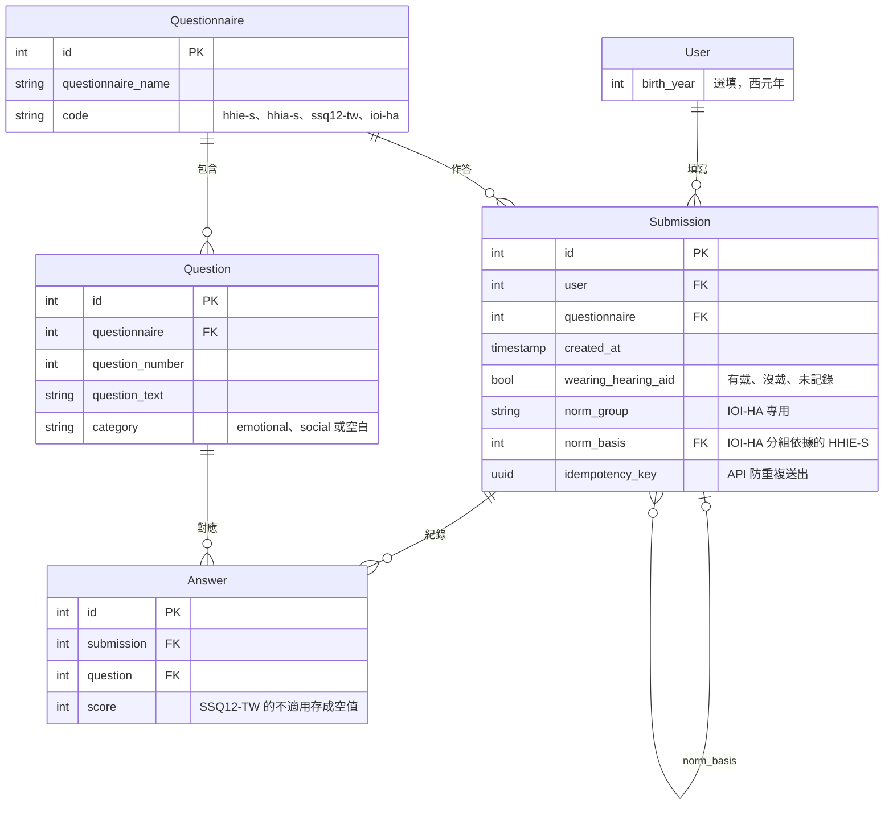

# HearWell

給聽損患者與家屬用的聽力健康自我照護工具。

台灣 65 歲以上長者約四成有失能性聽損[^1]，但從察覺聽力問題到尋求協助往往拖延多年，有研究指出可達 10 年[^2]。這段延遲的代價不只是聽不清楚：沒有處理的聽力損失與孤獨、社交孤立有關[^3]，也是可改變的失智風險因子之一[^4]。

HearWell 在家就能用：還沒就醫的人，用標準化量表自我評估聽力對生活的影響，結果用白話說明並告訴下一步該做什麼；已經戴助聽器的人，可以評估助聽器帶來的幫助。每次結果都會留下紀錄，用趨勢圖看自己的變化，也能把聽力圖記下來、整理成報告給醫師或家人看。

本專案由執業聽力師開發。主要使用者是 65 歲以上的長輩，所以無障礙是基本要求，不是加分項。

**線上展示：** <https://hearwell.onrender.com/>

## 功能

- 註冊、登入（出生年選填，只收年份）；第一次使用前同意隱私權說明
- 選擇問卷並作答：依年齡與目的推薦問卷，也可以自己選
  - **HHIE-S**（65 歲以上）／**HHIA-S**（18–64 歲）：聽力對生活的影響，10 題，依總分分成三級
  - **SSQ12-TW**：日常聆聽能力，12 題，0–10 分，可答「不適用」，算整體平均
  - **IOI-HA**：助聽器效益量表，7 題，不算總分，逐題和常模比較
- 作答前標記這次「有沒有戴助聽器」；IOI-HA 以外一題一頁，中途離開可以接著答（存在這台裝置）
- 結果頁：分級、行動建議、作答明細
- 我的紀錄：每份問卷一個分頁，用趨勢圖看歷次變化；每份問卷可選一組「戴與不戴助聽器」的結果比較
- 聽力圖：在圖上拖曳輸入、自動算四頻平均與程度、修改、兩張比較
- 聽力報告：列印友善的網頁（可存成 PDF），也能產生 7 天有效的分享連結給家人
- 給家人的溝通與陪伴頁（不用登入）
- 帳號設定：下載自己的全部資料（JSON）、刪除帳號與全部資料
- PWA：可以加到手機主畫面，像 app 一樣開啟

## 設計重點

- **無障礙優先（accessibility）**：字級一律用 `rem`、基礎字級 18px，觸控目標至少 44 × 44 px。用 axe-core 依 WCAG AA 量測基準線、逐項修正，見 [`docs/accessibility/accessibility_baseline.md`](docs/accessibility/accessibility_baseline.md)。
- **計分只用規則式程式碼（rule-based）**：分級門檻寫成門檻表（`scoring.THRESHOLDS`），不用 LLM 做分類或計算。總分不存在資料表裡，每次都從作答即時計算，網頁和 API 都走 `Submission` 的同一條計算路徑。見 [`docs/decisions/scoring.md`](docs/decisions/scoring.md) 與 [`docs/adr/`](docs/adr/)。
- **防止越權存取（IDOR）**：網頁和 API 的每個查詢都限定在登入者自己的資料；查別人的單筆紀錄回 404，和「不存在」無法分辨，有測試保護。見 [`docs/specs/phase-03/phase3.md`](docs/specs/phase-03/phase3.md)。
- **漸進式改架構（Strangler pattern）**：Django template 頁面與 `/api/` 並存、共用 model 與業務邏輯，只有互動重的頁面改用 React，`main` 任何時候都是完整可用的產品。前端和後端同源部署，沿用 session cookie 登入，不需要 JWT 或 CORS。
- **冪等寫入（idempotency）**：送出作答的 API 要求帶 `Idempotency-Key`，網路重試不會存成兩筆；同一個 key 送不同內容會回 409。網頁版表單也用同樣的收據編號防止連按兩次。見 [`docs/specs/phase-05/phase5_api_submit.md`](docs/specs/phase-05/phase5_api_submit.md)。
- **個資最小化**：出生年只收年份；錯誤監控只送錯誤類型、位置與網址路徑，不送作答、表單或使用者資料；分享連結不顯示名稱與出生年。

## 技術

| 層 | 使用 |
|---|---|
| 後端 | Python 3.13、Django 5.2、Django REST Framework、drf-spectacular（OpenAPI） |
| 資料庫 | PostgreSQL 18（正式環境 Neon，本機 Docker） |
| 前端 | Django template＋Bootstrap 5.3.8＋自訂樣式；互動重的頁面（趨勢圖、作答頁、聽力圖）用 React 19＋Vite＋Recharts |
| 部署 | Render、whitenoise 提供靜態檔、Sentry 錯誤監控 |
| 品質 | Django test、Vitest、Playwright（端對端）、Ruff；GitHub Actions 通過才能合併與部署 |

## 資料模型

`User` 繼承 Django 的 `AbstractUser`。外鍵都是 `PROTECT`（有作答紀錄的資料不能被連帶刪除），例外是 `norm_basis`（`RESTRICT`）和聽力圖的點（跟著聽力圖刪）；刪除帳號一律走 `User.delete_with_data()`，在一個交易裡由下往上刪。
總分不存欄位，由 `Submission` 用一次 `aggregate` 即時算出總分與分項。

下圖只畫問卷相關的資料表；另外還有 `Audiogram`／`AudiogramPoint`（聽力圖與每個點）、`Consent`（同意紀錄）、`ReportShare`（報告分享連結）、`ReportComparison`（每份問卷一組戴／不戴比較），都只連到 `User`。



## API

全部需要登入，只回傳登入者自己的資料。IOI-HA 只在網頁版，不在 API 裡。完整規格見 [`docs/api/schema.yaml`](docs/api/schema.yaml)。

| 方法與網址 | 用途 |
|---|---|
| `GET /api/questionnaires/` | 問卷列表與分級說明 |
| `GET /api/questionnaires/{id}/` | 單份問卷的題目與選項 |
| `GET /api/submissions/` | 自己的作答紀錄（cursor 分頁，新的在前） |
| `POST /api/submissions/` | 送出作答（需要 `Idempotency-Key` header） |
| `GET /api/submissions/{id}/` | 單筆結果與作答明細 |
| `POST /api/audiograms/` | 新增聽力圖（需要 `Idempotency-Key` header） |
| `GET`／`PUT /api/audiograms/{id}/` | 單張聽力圖；`PUT` 整張取代 |
| `GET /api/schema/` | OpenAPI schema |

## 本機開發

### 需要先安裝

- Python 3.13
- Node.js 24（版本見 `.node-version`）
- Docker Desktop（用來執行本機的 PostgreSQL）

### 第一次設定

1. 取得程式碼、建立虛擬環境、安裝套件

   ```bash
   git clone https://github.com/minuet878-prog/HearWell.git
   cd HearWell
   python3.13 -m venv .venv
   source .venv/bin/activate
   pip install -r requirements-dev.txt
   npm ci --prefix frontend
   ```

   `requirements-dev.txt` 包含正式環境的套件，再加上開發用的 debug-toolbar、ruff 和 playwright。

2. 啟動 PostgreSQL 容器（版本與正式環境一致，為 18）

   ```bash
   docker run -d --name hearwell-db \
     -e POSTGRES_USER=hearwell \
     -e POSTGRES_PASSWORD=password \
     -e POSTGRES_DB=hearwell_dev \
     -p 127.0.0.1:5432:5432 \
     -v hearwell-pgdata:/var/lib/postgresql \
     postgres:18
   ```

   - 連接埠只綁定 `127.0.0.1`，區域網路上的其他裝置連不到資料庫
   - 資料存在 `hearwell-pgdata` volume，容器停止或重建都不會遺失
   - PostgreSQL 18 起，volume 要掛在 `/var/lib/postgresql`，不是舊版的 `/var/lib/postgresql/data`

3. 設定環境變數

   ```bash
   cp .env.example .env
   ```

4. 建置前端、建立資料表、載入問卷、建立管理員

   ```bash
   npm run build --prefix frontend
   python manage.py migrate
   python manage.py loaddata questions_fixture.json
   python manage.py seed_hhia_s
   python manage.py seed_ssq12
   python manage.py createsuperuser
   ```

5. 啟動開發伺服器

   ```bash
   python manage.py runserver
   ```

### 日常使用

電腦重開機後容器會停止，先打開 Docker Desktop，再執行：

```bash
docker start hearwell-db
```

直接進資料庫下 SQL：

```bash
docker exec -it hearwell-db psql -U hearwell -d hearwell_dev
```

改了 `frontend/` 的程式碼，要重新 `npm run build --prefix frontend` 才會出現在頁面上。

### 環境變數

| 變數 | 必填 | 說明 |
|---|---|---|
| `DATABASE_URL` | 是 | 格式 `postgres://使用者:密碼@主機:埠/資料庫`，缺少時啟動即報錯 |
| `DEBUG` | 否 | 本機開發設為 `True`；正式環境不設定或設為 `False` |
| `SECRET_KEY` | 正式環境必填 | `DEBUG=False` 時缺少會報錯 |
| `ALLOWED_HOSTS` | 正式環境必填 | 以逗號分隔；`DEBUG=False` 時缺少會報錯，本機沒設時用 `127.0.0.1,localhost`；設成空的一律報錯 |

## 常用指令

```bash
python manage.py test --settings=config.test_settings  # 後端測試（不需要先 collectstatic）
python manage.py test --settings=config.test_settings e2e.main_flow  # 端對端測試（先建置前端；第一次要 python -m playwright install chromium）
npm test --prefix frontend                             # 前端測試
npm run build --prefix frontend                        # 前端建置
ruff check --fix .                                     # lint
python manage.py makemigrations --check --dry-run      # 確認沒有漏掉的 migration
python manage.py check --deploy                        # 部署前安全檢查（DEBUG=False 下執行）
```

## 部署

部署在 Render，`main` 有新 commit 且 CI 通過後自動部署。`build.sh` 依序執行：

1. `pip install -r requirements.txt`
2. `check --deploy --fail-level WARNING`：安全設定有任何警告就停止部署
3. `npm ci`、`npm run build`：建置前端
4. `collectstatic`
5. `migrate`
6. `loaddata questions_fixture.json`：載入 HHIE-S、IOI-HA 題目
7. `seed_hhia_s`、`seed_ssq12`：載入 HHIA-S、SSQ12-TW 題目（不指定 id，不會蓋掉舊題目）

因為每次部署都會重新載入題目，已經上線的題目不能直接修改，要改題目就新增一份問卷。

## 文件

- [文件總覽](docs/README.md)：按規劃、無障礙、API、部署與歷史紀錄查找
- [`docs/roadmap.md`](docs/roadmap.md)：目前進度、待辦與構想
- [`docs/adr/`](docs/adr/)：2026-10-18 之後的決策紀錄，一個決策一個檔
- [`docs/verification/`](docs/verification/)：每張票的測試、審查與本人驗收紀錄
- [`docs/decisions/`](docs/decisions/README.md)：2026-10-18 以前的決策、理由與踩過的坑，依主題分檔
- [歷史規格索引](docs/specs/README.md)：依 Phase 分類的規格與驗收條件
- [歷史審查索引](docs/reviews/README.md)：依 Phase 查找計畫審查、實作審查與對應規格
- [`docs/accessibility/accessibility_baseline.md`](docs/accessibility/accessibility_baseline.md)：無障礙量測方法與結果

## 參考資料

[^1]: 財團法人PSA華科慈善基金會（2019）。台灣最大規模高齡聽力篩檢報告。2016–2019 年篩檢 9,055 人；失能性聽損定義為好耳平均聽閾大於 40 dB HL；為篩檢資料，非全國隨機抽樣。<https://www.psa.org.tw/en/?p=7910>
[^2]: Davis A, Smith P, Ferguson M, Stephens D, Gianopoulos I. Acceptability, benefit and costs of early screening for hearing disability: a study of potential screening tests and models. *Health Technol Assess.* 2007;11(42).
[^3]: Shukla A, et al. Hearing loss, loneliness, and social isolation: a systematic review. *Otolaryngol Head Neck Surg.* 2020;162(5):622–633. doi:[10.1177/0194599820910377](https://doi.org/10.1177/0194599820910377)
[^4]: Livingston G, Huntley J, Liu KY, et al. Dementia prevention, intervention, and care: 2024 report of the Lancet standing Commission. *Lancet.* 2024;404(10452):572–628. doi:[10.1016/S0140-6736(24)01296-0](https://doi.org/10.1016/S0140-6736(24)01296-0)
